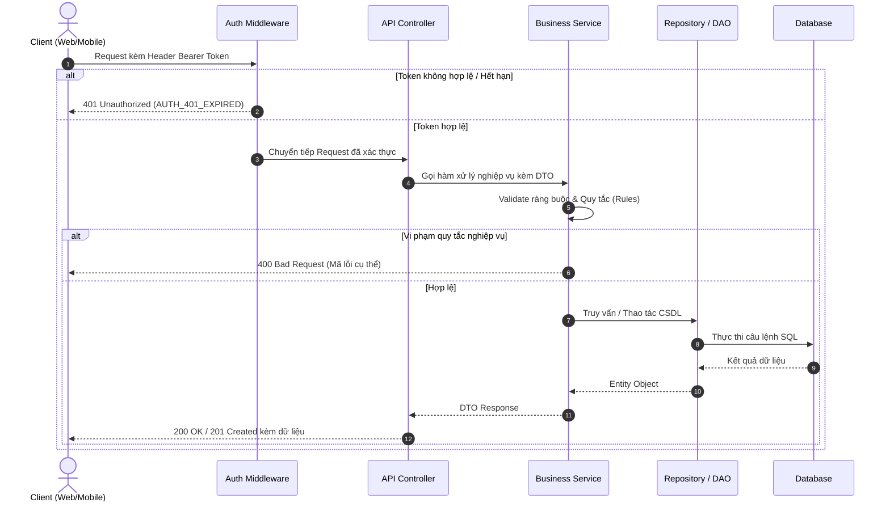

# 🔌 Template Thiết Kế Chi Tiết API (API Detailed Design Template)

> **Mục đích:** Tài liệu thiết kế chi tiết (Detail Design) cho từng Endpoint API, làm căn cứ chuyển giao giữa SA/BA và Backend/Frontend Developer. Áp dụng được cho mọi dự án phần mềm.

---

## 1. Thông Tin Nhận Diện & Tổng Quan (Overview)

| Trường Thông Tin | Chi Tiết Đặc Tả |
|---|---|
| **ID API:** | `<API-MOD-001: Ví dụ: API-AUTH-001, API-STD-002, API-ORD-003>` |
| **Tên API:** | `<TÊN_CHỨC_NĂNG: Ví dụ: Đăng nhập hệ thống / Lấy danh sách học sinh / Tạo mới đơn hàng>` |
| **Phương thức (Method):** | `GET` \| `POST` \| `PUT` \| `PATCH` \| `DELETE` |
| **Đường dẫn (Endpoint):** | `/api/v1/<resource-path>` (Ví dụ: `/api/v1/students/{id}/scores`) |
| **Phân quyền (RBAC):** | `<Quyền truy cập: ADMIN | TEACHER | USER | PUBLIC>` |
| **Mục đích (Purpose):** | `<Mô tả ngắn gọn API này sinh ra để giải quyết nhu cầu nghiệp vụ gì>` |
| **Tần suất gọi dự kiến:** | `<Ví dụ: 10 req/s, Real-time khi bấm nút Lưu>` |

---

## 2. Luồng Xử Lý Nghiệp Vụ (Business & Sequence Flow)



---

## 3. Đặc Tả Chi Tiết Kỹ Thuật (Technical Detail)

### 3.1. Headers
| Tên Header | Bắt buộc | Giá trị mẫu / Ghi chú |
|---|---|---|
| `Authorization` | Có | `Bearer <access_token>` |
| `Content-Type` | Có | `application/json` |

### 3.2. Tham số đường dẫn (Path Variables) / Query Parameters
| Tham Số | Vị Trí | Kiểu Dữ Liệu | Bắt Buộc | Mô Tả Nghiệp Vụ |
|---|---|---|---|---|
| `id` | Path | `UUID / int` | Có | Định danh bản ghi cần thao tác |
| `status` | Query | `string` | Không | Lọc theo trạng thái (`ACTIVE`, `PENDING`) |
| `page` | Query | `int` | Không | Số trang (Mặc định: 1) |
| `limit` | Query | `int` | Không | Số bản ghi mỗi trang (Mặc định: 20) |

### 3.3. Dữ Liệu Đầu Vào (Request Body - DTO)
```json
{
  "<field_name_1>": "<sample_value>",
  "<field_name_2>": 100,
  "<status_field>": "ACTIVE"
}
```

### 3.4. Dữ Liệu Đầu Ra Thành Công (Response 200/201 - DTO)
```json
{
  "code": "SUCCESS",
  "message": "<Câu thông báo thành công lấy từ bảng Message>",
  "data": {
    "id": "<uuid-or-id>",
    "<field_name_1>": "<sample_value>",
    "created_at": "2026-11-24T08:00:00Z"
  }
}
```

---

## 4. Câu Lệnh SQL Thuần Thực Thi (Raw SQL Queries)

> 💡 **Yêu cầu:** Ghi rõ câu lệnh SQL thuần (Raw SQL) tương ứng để phục vụ kiểm tra hiệu năng, debug hoặc viết Repository.

### 4.1. Câu lệnh kiểm tra ràng buộc / Tìm kiếm (Select):
```sql
SELECT 
    id, 
    code, 
    name, 
    status, 
    created_at
FROM 
    <table_name>
WHERE 
    id = :id 
    AND status = 'ACTIVE';
```

### 4.2. Câu lệnh Thêm mới / Cập nhật (Insert/Update):
```sql
UPDATE <table_name>
SET 
    <column_1> = :val_1,
    status = :status,
    updated_at = CURRENT_TIMESTAMP
WHERE 
    id = :id;
```

---

## 5. Bảng Danh Mục Thông Điệp & Mã Lỗi Trả Về (Messages & Error Codes)

| HTTP Status | Mã Lỗi (Code) | Tiêu Đề | Nội Dung Thông Điệp Cho Người Dùng |
|---|---|---|---|
| **200 OK** | `SUCCESS_UPDATE` | Thành công | "Cập nhật dữ liệu thành công." |
| **400 Bad Request** | `ERR_RULE_VIOLATION` | Lỗi nghiệp vụ | "Giá trị không hợp lệ theo quy tắc `{rule_name}`." |
| **401 Unauthorized**| `AUTH_TOKEN_EXPIRED` | Hết phiên | "Phiên làm việc đã hết hạn. Vui lòng đăng nhập lại." |
| **403 Forbidden** | `AUTH_ACCESS_DENIED` | Không có quyền | "Tài khoản của bạn không được phép thực hiện chức năng này." |
| **404 Not Found** | `ERR_RECORD_NOT_FOUND`| Không tìm thấy | "Không tìm thấy dữ liệu yêu cầu với ID: `{id}`." |

---

## 6. Lịch Sử Thay Đổi (Revision History)

| Phiên Bản (Ver) | Ngày Cập Nhật | Người Thực Hiện | Tóm Tắt Nội Dung Thay Đổi | Phê Duyệt |
|---|---|---|---|---|
| `1.0.0` | 2026-11-24 | `<Tên Tác Giả / BA>` | Khởi tạo tài liệu thiết kế chi tiết API | `<Tech Lead>` |
| `1.1.0` | YYYY-MM-DD | `<Tên>` | Bổ sung trường query parameter `status` | `<Tech Lead>` |
