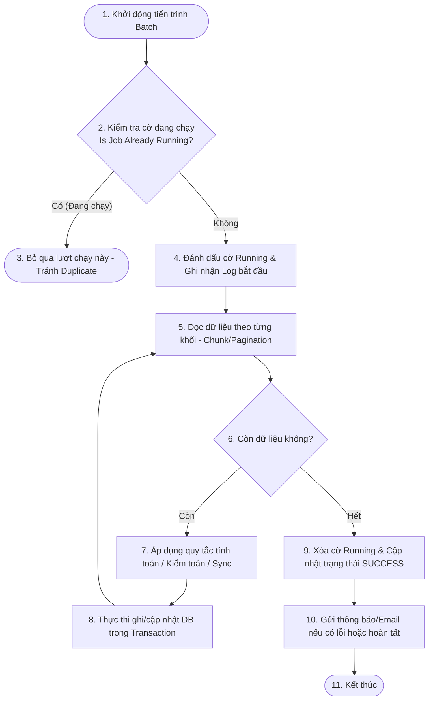

# ⚙️ Template Thiết Kế Tiến Trình Định Kỳ / Tự Động (Batch / Cron Job Detailed Design)

> **Mục đích:** Tài liệu thiết kế chi tiết cho các tiến trình chạy nền (Background Worker / Batch Job / Scheduled Cron) xử lý dữ liệu lớn, tính toán tổng hợp định kỳ hoặc dọn dẹp hệ thống.

---

## 1. Thông Tin Nhận Diện & Tổng Quan (Overview)

| Trường Thông Tin | Chi Tiết Đặc Tả |
|---|---|
| **ID Batch:** | `<BAT-MOD-001: Ví dụ: BAT-AUDIT-001, BAT-SYNC-002, BAT-CLEAN-003>` |
| **Tên Tiến Trình:** | `<TÊN_TIẾN_TRÌNH: Ví dụ: Quét kiểm toán dữ liệu rèn luyện / Tổng hợp điểm tháng / Dọn dẹp token hết hạn>` |
| **Lịch Chạy (Schedule):** | `<Cron Expression: Ví dụ: 0 0 * * * (Hàng ngày lúc 00:00) | 0 */1 * * * (Mỗi giờ 1 lần)>` |
| **Cơ Chế Kích Hoạt:** | `Scheduled (Tự động theo lịch)` \| `Manual Trigger (Kích hoạt thủ công qua API/UI)` |
| **Mục đích (Purpose):** | `<Mô tả giải thích tại sao cần chạy batch này và nó giải quyết khối lượng công việc gì>` |
| **Mức Độ Ưu Tiên:** | `HIGH` (Ảnh hưởng kinh doanh) \| `MEDIUM` \| `LOW` (Tác vụ dọn dẹp) |
| **Thời Gian Chạy Dự Kiến:** | `<Ví dụ: Dưới 5 phút cho 50.000 bản ghi>` |

---

## 2. Luồng Xử Lý Tiến Trình (Batch Processing Flow)



---

## 3. Đặc Tả Chi Tiết Kỹ Thuật (Technical Detail)

### 3.1. Kích thước khối xử lý (Chunk / Batch Size)
* **Chunk Size:** `500 bản ghi / 1 transaction` (Tránh tràn bộ nhớ Heap và khóa bảng quá lâu).
* **Retry Strategy:** Thử lại tối đa `3 lần` nếu gặp lỗi Deadlock hoặc Timeout.

### 3.2. Điều Kiện Lọc Đầu Vào (Filter Criteria)
* Chỉ lấy các bản ghi có `status = 'ACTIVE'`.
* Thời gian cập nhật `updated_at >= CURRENT_DATE - INTERVAL '1 day'`.

### 3.3. Xử Lý Khi Gặp Lỗi (Exception & Fault Tolerance)
* **Lỗi từng bản ghi (Item Error):** Ghi log bản ghi lỗi vào bảng `batch_error_logs`, không làm dừng toàn bộ tiến trình.
* **Lỗi hệ thống (Crash/DB Down):** Rollback khối hiện tại, bắn alert qua Telegram/Slack Webhook cho đội ngũ trực.

---

## 4. Câu Lệnh SQL Thuần Thực Thi (Raw SQL Queries)

### 4.1. Câu lệnh trích xuất dữ liệu cần xử lý (Read Query):
```sql
SELECT 
    id, 
    code, 
    total_score, 
    status
FROM 
    <source_table>
WHERE 
    status = 'ACTIVE' 
    AND is_processed = FALSE
ORDER BY 
    id ASC
LIMIT :chunk_size;
```

### 4.2. Câu lệnh cập nhật hàng loạt sau xử lý (Batch Bulk Update):
```sql
UPDATE <source_table>
SET 
    status = 'PROCESSED',
    audited_at = CURRENT_TIMESTAMP
WHERE 
    id IN (:list_of_ids);
```

### 4.3. Câu lệnh ghi log tiến trình (Insert Batch Log):
```sql
INSERT INTO batch_execution_logs (
    batch_id, 
    status, 
    total_records, 
    success_count, 
    failed_count, 
    start_time, 
    end_time
) VALUES (
    :batch_id, 
    :status, 
    :total, 
    :success, 
    :failed, 
    :start_time, 
    CURRENT_TIMESTAMP
);
```

---

## 5. Bảng Danh Mục Thông Điệp & Nhật Ký Ghi Nhận (Messages & Logs)

| Mã Thông Điệp | Cấp Độ Log | Mẫu Thông Điệp Ghi Nhận (Log Pattern) |
|---|---|---|
| `BATCH_START` | `INFO` | `[BAT-001] Bắt đầu thực thi tiến trình lúc: {timestamp}` |
| `BATCH_CHUNK_DONE` | `DEBUG` | `[BAT-001] Đã xử lý xong khối {chunk_index}, số bản ghi: {count}` |
| `BATCH_ITEM_ERROR` | `WARN` | `[BAT-001] Lỗi tại bản ghi ID={id}: {error_message}` |
| `BATCH_SUCCESS` | `INFO` | `[BAT-001] Hoàn thành: {success_count}/{total} bản ghi. Thời gian: {duration_ms}ms` |
| `BATCH_FAILED` | `ERROR` | `[BAT-001] Tiến trình thất bại nghiêm trọng: {error_stack}` |

---

## 6. Lịch Sử Thay Đổi (Revision History)

| Phiên Bản (Ver) | Ngày Cập Nhật | Người Thực Hiện | Tóm Tắt Nội Dung Thay Đổi | Phê Duyệt |
|---|---|---|---|---|
| `1.0.0` | 2026-11-24 | `<Tên Tác Giả / Data Engineer>` | Khởi tạo tài liệu thiết kế Batch | `<Lead Architect>` |
