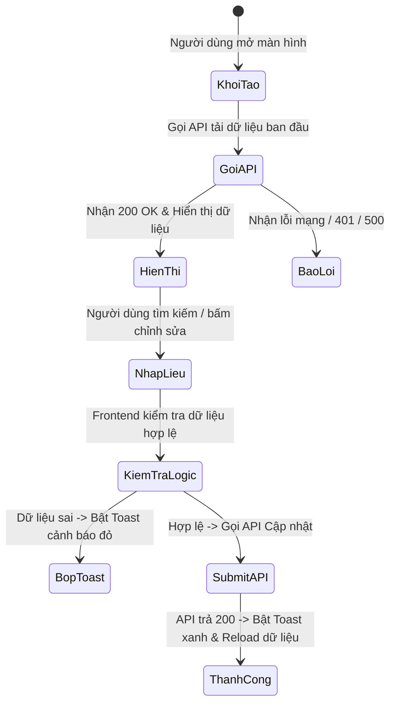

# 🖥️ Template Thiết Kế Chi Tiết Màn Hình Giao Diện (Screen Detailed Design Template)

> **Mục đích:** Tài liệu thiết kế chi tiết (UI/UX & Functional Screen Design) cho từng màn hình ứng dụng Web/Mobile, làm cầu nối chính xác giữa BA/Designer và Frontend Developer.

---

## 1. Thông Tin Nhận Diện & Tổng Quan (Overview)

| Trường Thông Tin | Chi Tiết Đặc Tả |
|---|---|
| **ID Màn Hình:** | `<SCR-MOD-001: Ví dụ: SCR-DASH-001, SCR-STD-002, SCR-RULES-003>` |
| **Tên Màn Hình:** | `<TÊN_MÀN_HÌNH: Ví dụ: Bảng điều khiển tổng quan / Danh sách học sinh / Trợ lý AI>` |
| **Đường Dẫn (Route):** | `/<path>` (Ví dụ: `/dashboard`, `/students`, `/students/:id`) |
| **Phân Quyền Truy Cập:** | `<Role được xem: ADMIN | TEACHER | USER | PUBLIC>` |
| **Mục đích (Purpose):** | `<Mô tả màn hình này cung cấp thông tin gì và cho phép người dùng thực hiện thao tác gì>` |
| **Loại Màn Hình (Kind):** | `Dashboard (Tổng quan)` \| `Entity List (Bảng CRUD)` \| `Form Detail` \| `AI Assistant` |

---

## 2. Bố Cục Giao Diện & Luồng Thao Tác (Wireframe Layout & User Flow)

### 2.1. Sơ đồ bố cục trực quan (ASCII / Layout Block):
```text
+-----------------------------------------------------------------------------------+
|  LOGO & APP TITLE                 [🔔 Thông báo]   [👤 Thông tin người dùng]      |
+-----------------------------------------------------------------------------------+
| [MENU SIDEBAR]  |  [BREADCRUMB: Trang chủ > Danh sách thực thể]                    |
|                 |-----------------------------------------------------------------|
| - Tổng quan     |  [🔍 Ô tìm kiếm]  [Bộ lọc Status ▼]      [+ Nút Thêm Mới]       |
| - Danh sách     |-----------------------------------------------------------------|
| - Trợ lý AI     |  STT | Mã      | Tên          | Thuộc tính 1 | Trạng thái | Thao tác|
| - Cài đặt       |  01  | ITEM-01 | Tên mẫu A    |      100     | Hoạt động  | [Sửa][Xóa|
|                 |  02  | ITEM-02 | Tên mẫu B    |       50     | Tạm khóa   | [Sửa][Xóa|
|                 |-----------------------------------------------------------------|
|                 |  [<< Trước]   Trang 1 / 5   [Tiếp >>]           (Hiển thị 20 dòng) |
+-----------------------------------------------------------------------------------+
```


### 2.2. Luồng thao tác người dùng (User Interaction Flow):


---

## 3. Đặc Tả Chi Tiết Thành Phần Giao Diện (Screen Component Detail)

### 3.1. Các phần tử điều khiển (Inputs, Buttons, Tables)
| Vị Trí / Tên Phần Tử | Loại (Control Type) | Điều Kiện Validation | Hành Động Khi Tương Tác |
|---|---|---|---|
| **Ô tìm kiếm** | Text Input | Tối đa 50 ký tự | Tự động lọc sau khi gõ (Debounce 300ms) |
| **Dropdown Bộ Lọc** | Select Box | Lấy danh sách từ ENUM | Lọc lại dữ liệu bảng theo trạng thái chọn |
| **Nút "+ Thêm mới"** | Primary Button | Cần quyền `ADMIN/TEACHER` | Mở Modal Form thêm mới |
| **Bảng dữ liệu** | Data Table | Phân trang 20 dòng | Bấm vào dòng để mở chi tiết học sinh |

### 3.2. Trạng thái giao diện đặc biệt (UI Edge States)
* **Loading State:** Hiển thị khung xương xám nhấp nháy (`Skeleton Loading`).
* **Empty State:** Khi không có dữ liệu, hiển thị hình minh họa + dòng chữ *"Chưa có dữ liệu nào được ghi nhận"*.
* **Error State:** Hiển thị hộp thông báo lỗi + nút *"Tải lại trang"*.

---

## 4. Danh Sách API & Câu Lệnh SQL Thuần Tương Ứng (APIs & Raw SQL)

Màn hình này phụ thuộc vào các API và truy vấn dữ liệu sau:

### 4.1. API Tải danh sách hiển thị ban đầu:
* **Endpoint:** `GET /api/v1/<entities>?status=ACTIVE&page=1&limit=20`
* **Câu lệnh SQL thuần chạy ngầm tại Backend:**
  ```sql
  SELECT 
      e.id,
      e.code,
      e.name,
      e.attribute_value,
      e.status,
      e.created_at
  FROM 
      <entity_table> e
  WHERE 
      e.status = 'ACTIVE'
  ORDER BY 
      e.id ASC
  LIMIT 20 OFFSET 0;
  ```

### 4.2. API Thao tác xóa bản ghi:
* **Endpoint:** `DELETE /api/v1/<entities>/{id}`
* **SQL thuần:**
  ```sql
  UPDATE <entity_table> 
  SET status = 'DELETED', updated_at = CURRENT_TIMESTAMP 
  WHERE id = :id;
  ```


---

## 5. Bảng Danh Mục Thông Điệp Trên Giao Diện (UI Messages & Toast Alerts)

| Vị Trí Hiển Thị | Loại (Type) | Nội Dung Thông Báo |
|---|---|---|
| **Toast Góc Phải** | `SUCCESS` | "Lưu thông tin thành công!" |
| **Hộp Thoại Modal** | `CONFIRM` | "Bạn có chắc chắn muốn xóa bản ghi này không? Hành động này không thể hoàn tác." |
| **Dưới Ô Nhập Liệu**| `ERROR` | "Vui lòng nhập họ và tên không chứa số hoặc ký tự đặc biệt." |
| **Banner Đầu Trang**| `WARNING` | "Hệ thống phát hiện 2 bản ghi có điểm bất thường cần duyệt lại." |

---

## 6. Lịch Sử Thay Đổi (Revision History)

| Phiên Bản (Ver) | Ngày Cập Nhật | Người Thực Hiện | Tóm Tắt Nội Dung Thay Đổi | Phê Duyệt |
|---|---|---|---|---|
| `1.0.0` | 2026-11-24 | `<Tên Tác Giả / Frontend Lead>` | Khởi tạo tài liệu thiết kế màn hình | `<Product Owner>` |
