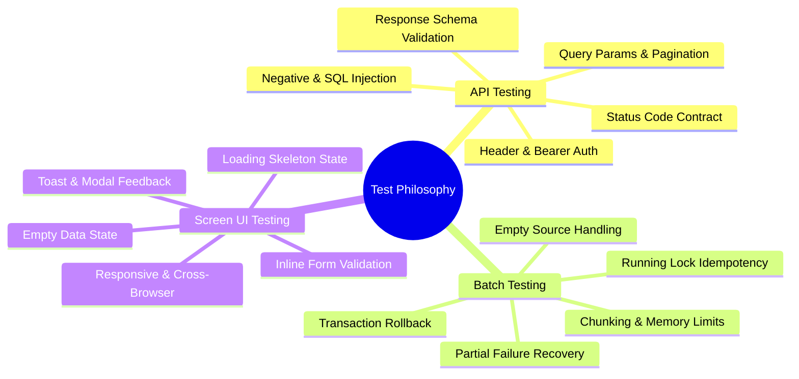

# 🧪 Quan Điểm Kiểm Thử & Ma Trận Các Pattern Kiểm Thử (Testing Philosophy & Pattern Matrix)

> **Mục tiêu:** Định nghĩa triết lý kiểm thử toàn diện, nguyên tắc bao phủ (Coverage Principles) và toàn bộ các Test Pattern áp dụng cho cả 3 thành phần cốt lõi: **API**, **Tiến trình ngầm (Batch)** và **Giao diện người dùng (Screen)**.

---

## 1. Triết Lý Kiểm Thử Cốt Lõi (Testing Philosophy)

1. **Shift-Left Testing (Kiểm thử sớm):** Kiểm thử bắt đầu ngay từ khâu thiết kế Spec và DTO, không đợi đến khi code xong mới test.
2. **Kim Tự Tháp Kiểm Thử (Testing Pyramid):**
   - *Unit Tests (70%):* Kiểm tra logic các hàm thuần (`rules`), công thức toán, chuyển đổi dữ liệu. Chạy siêu nhanh, độc lập.
   - *Integration Tests (20%):* Kiểm tra giao tiếp giữa các tầng: Controller ➔ Service ➔ Database, API Endpoints, Batch Jobs.
   - *End-to-End / UI Tests (10%):* Kiểm tra toàn vẹn luồng trải nghiệm người dùng trên màn hình giao diện Screen.
3. **Không Tin Dữ Liệu Đầu Vào (Zero-Trust Input):** Mọi tham số từ bên ngoài gửi vào hệ thống (Params, Body, File) đều phải được giả định là có thể chứa dữ liệu sai lệch, độc hại hoặc rỗng.

---

## 2. Ma Trận Các Test Pattern Bắt Buộc (Universal Test Patterns Matrix)

### Pattern 1: Kiểm Thử Trường Hợp Bình Thường (Happy Path / Positive Cases)
* **Khái niệm:** Dữ liệu chuẩn mực, đầy đủ và hợp lệ theo đúng kịch bản mong muốn nhất.
* **Mục tiêu:** Đảm bảo hệ thống trả về đúng kết quả (200 OK / 201 Created / Success State) và lưu đúng dữ liệu vào CSDL.

### Pattern 2: Phân Tích Giá Trị Biên (Boundary Value Analysis - BVA)
* **Khái niệm:** Lỗi phần mềm thường xuất hiện tập trung tại các điểm ranh giới.
* **Quy tắc 3 điểm biên:** Giá trị ngay dưới biên (`Min - 1`), Giá trị tại biên (`Min`, `Max`), Giá trị ngay trên biên (`Max + 1`).
* **Ví dụ:** Ngưỡng điểm đổi quà là 10 ➔ Test tại 9 điểm (0 quà), 10 điểm (1 quà), 11 điểm (1 quà, 1 dư). Chuỗi độ dài max 50 ký tự ➔ Test tại 0, 1, 49, 50, 51 ký tự.

### Pattern 3: Phân Vùng Tương Đương (Equivalence Partitioning - EP)
* **Khái niệm:** Chia tập dữ liệu thành các nhóm tương đương (Hợp lệ và Không hợp lệ) để giảm số lượng test case nhưng vẫn đảm bảo độ phủ.
* **Ví dụ:** Tuổi học sinh từ 6 đến 11 ➔ Nhóm âm (<0), Nhóm quá nhỏ (1-5), Nhóm hợp lệ (6-11), Nhóm quá tuổi (>11).

### Pattern 4: Dữ Liệu Rỗng, Khuyết Thiếu & Giá Trị Đột Biến (Null, Empty & Extreme Cases)
* **Các giá trị cần test:** `null`, `undefined`, chuỗi rỗng `""`, chuỗi toàn dấu cách `"   "`, mảng rỗng `[]`, số 0, số âm rất lớn, số thập phân dài ngoằng.

### Pattern 5: Định Dạng Sai & Dữ Liệu Độc Hại (Negative & Security Injection Cases)
* **Các trường hợp:**
  - Sai kiểu dữ liệu: Gửi chuỗi `"abc"` vào trường số nguyên `int`.
  - Sai format: Email không có `@`, ngày tháng sai định dạng `31/02/2026`.
  - Bảo mật: Chuỗi tấn công SQL Injection `' OR '1'='1`, chuỗi tấn công XSS ``, chuỗi Unicode tiếng Việt có dấu, emoji lạ.

### Pattern 6: Xung Đột & Trùng Lặp Dữ Liệu (Idempotency & Duplicate Cases)
* **Mục tiêu:** Gửi 2 request giống nhau liên tiếp (bấm đúp nút Lưu / mạng lag gửi lại):
  - Hệ thống phải bắt được lỗi trùng mã (409 Conflict) hoặc đảm bảo tính chất Idempotent (không tạo 2 bản ghi trùng).

### Pattern 7: Kiểm Thử Phân Quyền & Giả Mạo (Authorization & Role Tampering)
* **Các trường hợp:**
  - Không có Token đăng nhập (401 Unauthorized).
  - Token hết hạn hoặc chữ ký bị giả mạo (401 Unauthorized).
  - Đăng nhập quyền `VIEWER` nhưng cố tình gọi API sửa/xóa của `ADMIN` (403 Forbidden).

---

## 3. Đặc Thù Test Pattern Riêng Cho Từng Loại Thành Phần

### 3.1. Đối với API:
* Kiểm tra đúng HTTP Status Code (`200`, `201`, `400`, `401`, `403`, `404`, `409`, `422`, `500`).
* Kiểm tra Response JSON đúng Schema (không thiếu trường, đúng kiểu dữ liệu).
* Kiểm tra câu lệnh SQL thuần chạy ngầm không bị lỗi cú pháp và được tối ưu hóa Index.

### 3.2. Đối với Batch:
* **Kiểm tra phân khối (Chunking):** Xử lý 1.000 bản ghi với Chunk Size = 500 phải chia làm đúng 2 lượt chunk.
* **Kiểm tra cờ chống chạy trùng (Lock):** Khi job đang chạy, lượt kích hoạt thứ hai phải bị từ chối/bỏ qua.
* **Kiểm tra chịu lỗi từng phần (Fault Tolerance):** Bản ghi thứ 5 bị lỗi DB thì bản ghi thứ 1-4 vẫn commit thành công, bản ghi lỗi được ghi log riêng, tiến trình không bị crash toàn bộ.
* **Kiểm tra xử lý khi nguồn rỗng:** Khi bảng nguồn không có dữ liệu cần xử lý ➔ Job kết thúc êm thấm với `processed_count = 0`, không báo lỗi.

### 3.3. Đối với Screen:
* **Đủ 3 trạng thái giao diện:**
  - *Loading:* Khung xương nhấp nháy khi đang fetch dữ liệu.
  - *Empty:* Màn hình trống có hình minh họa và nút điều hướng khi danh sách rỗng.
  - *Error:* Hộp thoại báo lỗi và nút "Thử lại" khi mất mạng.
* **Kiểm tra tương tác Form:** Disable nút Submit khi form chưa hợp lệ; chống bấm liên tiếp (Double-click debounce).
* **Kiểm tra hiển thị Toast:** Thông báo xanh khi thành công, thông báo đỏ khi lỗi, Modal xác nhận khi bấm Xóa.
