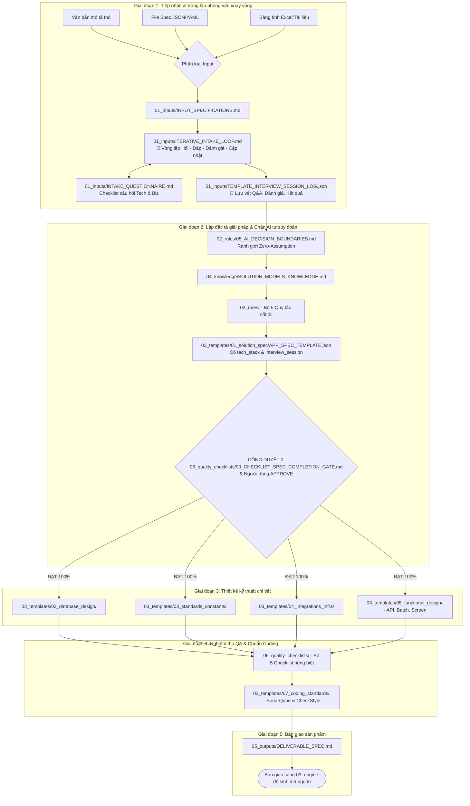

# 🧭 Hướng Dẫn Vận Hành Quy Trình Thiết Kế Phần Mềm Chuẩn Hóa (Standard Software Design Process)

> Thư mục **`01_process/`** là bộ quy trình làm việc chuẩn (Standard Operating Procedure - SOP) độc lập, trung lập với mọi công nghệ, dùng để chuyển hóa yêu cầu của người dùng thành thiết kế phần mềm hoàn chỉnh và bàn giao sang khâu lập trình.

---

## 🗺️ Bản Đồ Luồng Làm Việc (End-to-End Workflow Map)

---

## 📂 Danh Mục Cấu Trúc Thư Mục 01_process

| Thư mục / Thành phần | Chức năng trong quy trình |
|---|---|
| **`01_inputs/`** | Tiếp nhận và chuẩn hóa 3 dạng đầu vào: Mô tả tự do, File Spec có sẵn, Dữ liệu bảng tính. |
| **`02_rules/`** | Bộ 4 quy tắc cốt lõi: Đạo đức nghiệp vụ, AI & HITL, Kỹ thuật lập trình, An toàn bảo mật. |
| **`03_templates/`** | Hệ thống khung mẫu phân tầng: Solution Spec, Database ERD, Enums/Messages, Infra, Functional Design (API/Batch/Screen), 5 Checklist QA, Coding Standards. |
| **`04_knowledge/`** | Cơ sở tri thức mô hình giải pháp: Token economy, Game hóa, Đội nhóm, Mục tiêu cá nhân. |
| **`05_outputs/`** | Tiêu chuẩn nghiệm thu sản phẩm đầu ra khi bàn giao (Ứng dụng chạy được, Hướng dẫn, Báo cáo). |
